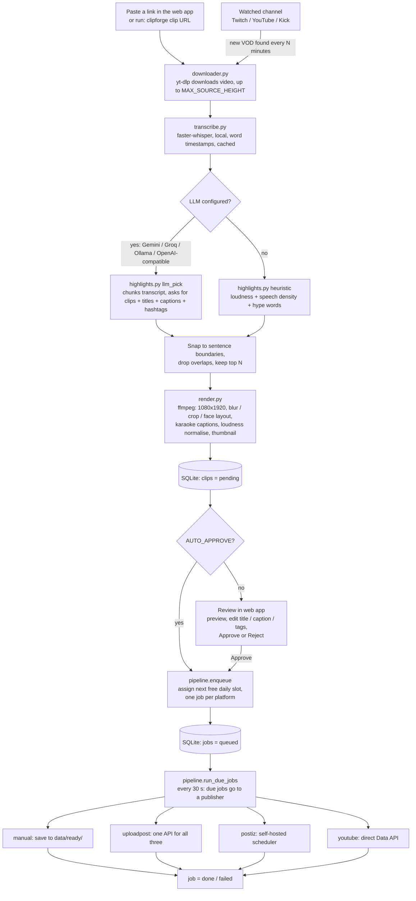

# ClipForge: project overview, workflow and contributor guide

ClipForge is a self-hosted tool that turns long videos and livestream VODs (Twitch, Kick, YouTube, or anything
[yt-dlp](https://github.com/yt-dlp/yt-dlp) supports) into captioned vertical clips, lets a human review them, and posts
them to YouTube Shorts, TikTok and Instagram Reels on a schedule. It is MIT licensed and runs on your own machine.

> User guide and setup steps: see [README.md](README.md). This document explains how the project works, so people
> can understand, run, extend and contribute to it.

---

## 1. Goals and non-goals

**Goals**
- Paste a link, get ready-to-post vertical clips with no manual editing.
- Works with **zero API keys** (local Whisper, offline highlight picker, "manual" publishing) and gets better with
  free keys (Gemini, Groq) or a fully local LLM (Ollama).
- Human-in-the-loop by default (review and edit before anything is posted), fully automatic if you choose.
- Small, readable codebase: Python standard library + a handful of well-known packages; no database server, no queue broker.

**Non-goals (today)**
- A full video editor. It cuts, reframes, captions and exports; it does not do timelines, b-roll or effects.
- Bypassing platform rules. Posting goes through official APIs or approved posting services only.
- Multi-user hosting. The web UI has no login and binds to localhost.

---

## 2. End-to-end workflow



### Step by step

1. **Ingest.** A URL arrives from the web UI, CLI, or the channel watcher. It is stored in the `sources` table with
   status `new`. The ingest worker picks sources up one at a time.
2. **Download.** `downloader.download()` uses yt-dlp (best video up to `MAX_SOURCE_HEIGHT` + best audio, merged to mp4).
   A local file path is accepted too. Live streams are refused (no VOD yet). Optional `--start/--end` downloads only a range.
3. **Transcribe.** `transcribe.transcribe()` extracts 16 kHz mono audio and runs faster-whisper with word timestamps
   and VAD. The transcript is cached as JSON next to the audio, so re-runs are instant.
4. **Pick moments.**
   - With an LLM: the transcript is split into ~25 minute chunks (60 s overlap); each chunk is sent with a prompt asking
     for clips of `CLIP_MIN_SECONDS`–`CLIP_MAX_SECONDS`, each with score, title, hook, reason, caption and hashtags.
   - Without an LLM: sliding windows are scored by loudness (RMS), speech rate, hype-word hits and `?`/`!` counts.
   - Either way, clip edges are snapped to sentence boundaries, overlapping clips are dropped, and the best N are kept.
   - If an LLM call fails or returns nothing, the heuristic is used, so a run never ends with zero clips for API reasons.
5. **Metadata.** Every clip gets a title, caption and hashtags (LLM, or a simple fallback from the transcript).
6. **Render.** `render.render_clip()` builds one ffmpeg filter graph:
   - `blur` (default): the full frame centered over a blurred, zoomed copy; nothing is cropped.
   - `crop`: scale to height and crop to 9:16 around `CROP_X`.
   - `face`: like `crop`, with `crop_x` found by OpenCV face detection (one position per clip).
   - Captions are an ASS subtitle file: 3–4 words at a time, active word highlighted, burned in.
   - Audio is loudness-normalised (EBU R128) with short fades; output is H.264/AAC, `+faststart`.
7. **Review.** Clips are saved with status `pending`. The web app shows each one with a player, score, and editable
   title/caption/hashtags. *Approve & queue* or *Reject*. (`AUTO_APPROVE=true` skips this.)
8. **Schedule.** `pipeline.next_slot()` gives the next free time from `POST_TIMES` (local time), capped by
   `MAX_POSTS_PER_DAY`. One `jobs` row per platform in `PLATFORMS`, all sharing that slot.
9. **Publish.** The poster loop wakes every 30 s. For each due job it picks the publisher configured for that
   platform (`PUBLISH_YOUTUBE`, `PUBLISH_TIKTOK`, `PUBLISH_INSTAGRAM`), builds a platform-specific title/caption, uploads,
   and records the result. Failures are retried (3 attempts, growing delay), then marked `failed` with the error.
   With `SCHEDULE_MODE=provider` the future slot is passed to the provider so the PC can be off at post time.
10. **Watch (self-download).** The watcher lists the newest videos of each watched channel every
    `CHECK_INTERVAL_MINUTES`, skips live streams and videos shorter than 10 minutes, and queues unseen ones as new sources.
    The first check of a channel only processes the newest `WATCH_BACKFILL` videos.

---

## 3. Architecture

```
                         ┌──────────────────────── clipforge/ ────────────────────────┐
 Browser ──HTTP──►  server.py ─┬─ ingest thread ─► pipeline.process_source ─► downloader / transcribe /
 (ui.html)                     │                                              highlights / face / render
                               ├─ poster thread ─► pipeline.run_due_jobs ──► publishers/*
                               └─ watcher thread ► watch.check_watches
                                                   │
 CLI (cli.py) ─────────────────────────────────────┤   all state in one SQLite file (db.py, WAL mode)
                                                   ▼
                                           data/clipforge.db · data/clips · data/work · data/ready
```

- One process, three background threads + the HTTP server. Each thread opens its own SQLite connection (WAL mode).
- No external services are required. Every network dependency is optional and isolated in one module.

### Module map

| File | Responsibility |
|---|---|
| `config.py` | Reads `.env`, exposes a `Settings` object; chooses LLM provider and per-platform publisher automatically |
| `downloader.py` | yt-dlp wrapper, local-file passthrough, optional time range |
| `transcribe.py` | faster-whisper, word timestamps, transcript cache |
| `llm.py` | Minimal JSON-returning client for Gemini, Groq, OpenAI-compatible APIs and Ollama; retries on 429/5xx |
| `highlights.py` | LLM and heuristic clip picking, sentence snapping, caption/hashtag generation |
| `face.py` | Optional OpenCV face detection for the `face` layout |
| `render.py` | ffmpeg filter graph: layouts, ASS captions, audio normalisation, thumbnail |
| `pipeline.py` | Orchestration: ingest, slot scheduling, approval, publishing loop |
| `watch.py` | Channel listing, "new VOD" detection |
| `db.py` | SQLite schema and queries |
| `publishers/` | `base.py` (interface + caption builder), `manual`, `uploadpost`, `postiz`, `youtube` |
| `server.py`, `ui.html` | Local web app (stdlib `http.server`, single-file UI, HTTP Range for video seeking) |
| `cli.py` | `serve`, `clip`, `watch`, `daemon`, `post`, `approve`, `status` |
| `tests/smoke_test.py` | Offline end-to-end check (synthetic video, no network or keys) |

### Data model (SQLite)

| Table | Key columns |
|---|---|
| `sources` | `url` (unique), `title`, `uploader`, `status`: `new` → `working` → `done` / `error` / `skipped` |
| `clips` | `source_id`, `path`, `start`, `end`, `score`, `title`, `caption`, `hashtags` (JSON), `status`: `pending` / `approved` / `rejected` |
| `jobs` | `clip_id`, `platform`, `due` (epoch), `status`: `queued` → `done` / `failed` / `skipped`, `attempts`, `result`; unique per (clip, platform) |
| `watches` | `url`, `last_checked` |

### Web API (localhost)

| Route | Purpose |
|---|---|
| `GET /` | the UI |
| `GET /api/state` | sources, clips, jobs, watches, active config |
| `GET /media/<file>` | clip video/thumbnail (basename only, Range supported) |
| `POST /api/add` | `{url, start?, end?}` queue a source |
| `POST /api/watch` | `{url}` add, or `{url, remove: true}` |
| `POST /api/clip/<id>` | `{title?, caption?, hashtags?, action?: approve / reject / post_now / save}` |

---

## 4. Publishing options

| Publisher | Platforms | Cost | Notes |
|---|---|---|---|
| `manual` | all | free | Copies the clip and a caption `.txt` to `data/ready/<platform>/` |
| `uploadpost` | all | free tier + paid | Upload-Post API (`POST /api/upload`, `Authorization: Apikey`). Their docs say TikTok is not on the Free plan |
| `postiz` | all | free if self-hosted | Postiz public API: list channels, upload media, create post. 30 requests/hour. Self-hosting needs your own platform developer apps |
| `youtube` | YouTube | free | YouTube Data API v3 resumable upload. Unaudited API projects are limited to private uploads and ~6 uploads/day of quota |

Each platform is routed independently, so mixing is normal (for example YouTube + Instagram through Upload-Post, TikTok manual).

### Writing a new publisher

1. Create `clipforge/publishers/myservice.py`:
   ```python
   from .base import Publisher, PublishError
   class MyPublisher(Publisher):
       name = "myservice"
       def publish(self, platform, video, text, schedule_at=None) -> str:
           # text = {"title": ..., "description": ..., "tags": [...]}
           # upload `video` (Path), return a url/id string, raise PublishError on failure
   ```
2. Register it in `publishers/__init__.py::get_publisher`.
3. Add its settings to `config.py` and `.env.example`, and a row in the table above.

### Adding an LLM provider
Add a branch in `llm.ask_json` that returns parsed JSON, and the provider detection in `config.py`.

---

## 5. Configuration

All settings live in `.env` (template: `.env.example`, every key documented there). Groups: LLM provider keys,
clipping behaviour (`WHISPER_MODEL`, `CLIPS_PER_VIDEO`, `CLIP_MIN/MAX_SECONDS`, `LAYOUT`, caption font/size),
automation (`AUTO_APPROVE`, `POST_TIMES`, `MAX_POSTS_PER_DAY`, `SCHEDULE_MODE`, `PLATFORMS`, watcher interval and backfill),
and publishing (`PUBLISHER`, `PUBLISH_<PLATFORM>`, provider credentials).

---

## 6. Status: what has and has not been verified

Be upfront with contributors and users about this.

**Verified (automated, offline, `python tests/smoke_test.py`)**
- Offline highlight picker, sentence snapping, overlap removal
- ffmpeg render to exactly 1080×1920 (blur and crop layouts), karaoke captions visible
- Daily slot scheduling (one slot per clip, per-day cap), job creation per platform
- Manual publisher output, retry bookkeeping, SQLite state
- Web app routes: state, UI, media with HTTP Range, path-traversal rejection, clip editing, input validation

**Written from API documentation but not run against the live services** (needs real accounts and keys, so these are
the first things to test and fix)
- yt-dlp downloads from Twitch / Kick / YouTube, and channel listing for the watcher (Kick listing in particular depends on yt-dlp support)
- faster-whisper model download and real transcription
- Gemini, Groq, Ollama and OpenAI-compatible LLM calls
- Upload-Post, Postiz and YouTube uploads (field names were checked against their docs; Instagram `media_type` is left to the service default)
- OpenCV face detection

**Known limitations / good first issues**
- `face` layout picks one crop position per clip; it does not follow a moving speaker. Multi-speaker or camera-cut tracking is the obvious upgrade.
- No analytics or feedback loop (which clips performed) yet.
- Web UI has no authentication; keep it on `127.0.0.1` or put it behind a reverse proxy with auth.
- Rendering is CPU-bound (libx264, boxblur). A hardware-encoder option (NVENC / VideoToolbox) would help.
- Very long sources are transcribed in one pass; chunked or resumable transcription would help on weak machines.
- TikTok direct posting needs an approved TikTok developer app; unaudited apps can only post private or draft.
- Titles/captions are English-centric prompts; the language handling is left to the model.
- Roadmap ideas: per-frame speaker tracking, b-roll/emoji captions styles, Windows installer / Docker image, clip performance analytics, multi-account support, a `--dry-run` publisher.

---

## 7. Responsible use

- Clip only content you own or have permission to use. Many streamers run official clipping programs.
- Respect each platform's terms, API quotas and automation rules. Disclose AI-generated or reposted content where the platform requires it.
- Credit lines are added to descriptions by default (`CREDIT=true`); keep them on for reposted content.
- Never commit `.env`, `client_secret.json` or `data/` (already in `.gitignore`).

---

## 8. Contributing

1. Fork, create a branch, keep changes small and focused.
2. Run `python tests/smoke_test.py` before opening a PR (needs ffmpeg).
3. Test anything touching a live service with your own account and say what you tested in the PR.
4. Keep the dependency list short; optional features should import lazily (see `face.py`, `publishers/youtube.py`).

License: [MIT](LICENSE).
